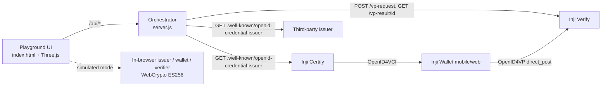

# Inji Interop Playground

A browser sandbox to issue, hold, present and verify Verifiable Credentials across Inji Certify, Inji Wallet, Inji Verify and third-party OpenID4VCI / OpenID4VP products, and to see exactly where interoperability breaks.

## What works
- **Simulated mode (no setup):** real ES256 signing and verification in the browser, 8-way issuer x wallet x verifier matrix, 4 attack scenarios, protocol trace, JSON report export, 3D scene, guide robot.
- **Live mode (needs this backend):** discovers real credential formats from Inji Certify and a third-party issuer, and creates a real Inji Verify presentation request (QR) that a real Inji Wallet can answer.

## Architecture

## Install and run
1. Start Inji Certify and Inji Verify with their Docker Compose setups (see the `docker-compose` folders in github.com/mosip/inji-certify and github.com/mosip/inji-verify).
2. `cp .env.example .env` and set the three URLs to your running services.
3. `npm start` (Node 20+, no dependencies), then open http://localhost:3000.
4. No backend? Just open `index.html` in a browser for simulated mode, or host it on GitHub Pages.

## API (orchestrator)
| Endpoint | Purpose |
|---|---|
| GET /api/discover | Reads each issuer metadata and returns supported formats (`ldp_vc`, `sd-jwt`) plus verifier status |
| POST /api/verify/request | Calls Inji Verify `POST /vp-request`; returns `{txn, uri}` for the QR |
| GET /api/verify/result/:txn | Proxies Inji Verify `GET /vp-result/{txn}`; `{pending:true}` until the wallet submits |

Inji Verify endpoints used: `/vp-request`, `/vp-result/{transactionId}`. Issuer metadata path is `/.well-known/openid-credential-issuer` (under `/v1/certify/issuance/` on some Certify setups).

## Test data
Sample holder `Asha Rao`, ID `BLR-2026-0417`, detail `B.Tech Computer Science`, types University ID and Farmer Certificate. Keys are generated fresh in the browser on each load. No real personal data.

## Test cases
| # | Case | Expected |
|---|---|---|
| 1 | sd-jwt, Inji issuer to Inji wallet to Inji verifier | PASS |
| 2 | ldp_vc through Third-party Issuer | FAIL: issuer does not offer ldp_vc |
| 3 | ldp_vc into Third-party Wallet from Inji issuer, sd-jwt offer | FAIL: wallet cannot accept sd-jwt |
| 4 | Tampered claim | REJECTED: signature check fails |
| 5 | Expired credential | REJECTED: expiry check fails |
| 6 | Replayed nonce | REJECTED: nonce check fails |
| 7 | Revoked credential | REJECTED: revocation check fails |
| 8 | Live: scan QR with Inji Wallet, share credential | `/vp-result` returns a verification result |

Record your actual run results in `interop-report.json` (matrix tab, Export) and add screenshots.

## Known limits
Live mode has not been run against a deployed stack by the author of this scaffold. Field names in the Inji Verify `/vp-request` response, and the issuer metadata URL, differ between releases: adjust `server.js` if the QR link is empty. Full OpenID4VCI issuance against Inji Certify needs eSignet login and a wallet, so issuance is tested by scanning offers with Inji Wallet, not automated here.
